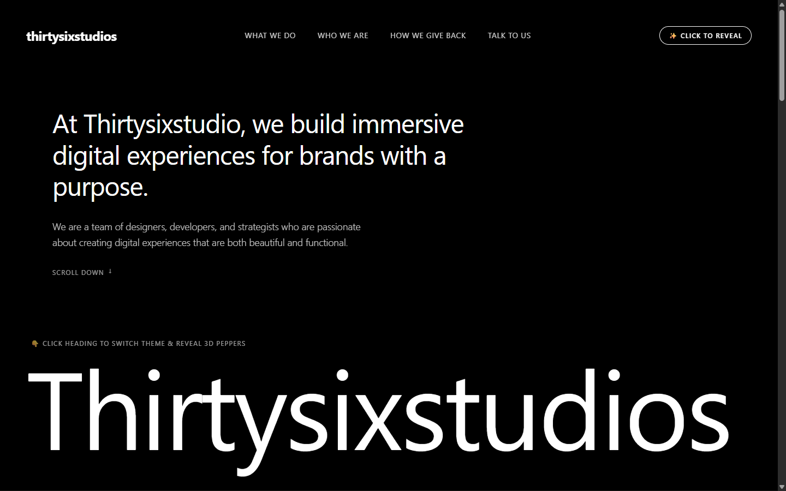
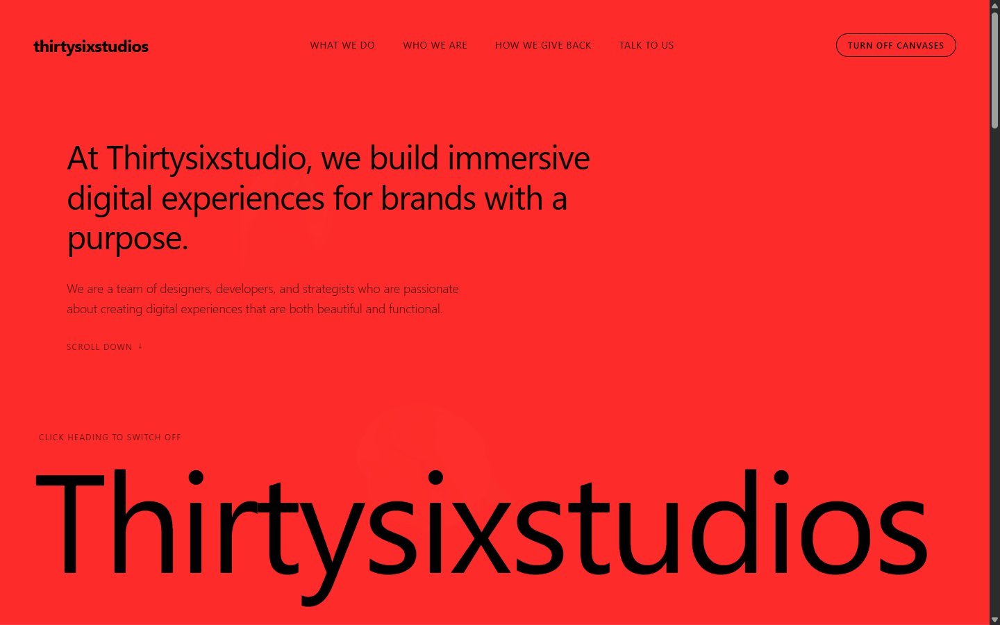

# Thirtysixstudio — Interactive Canvas & GSAP Creative Experience

An award-winning agency portfolio recreation inspired by **ThirtySixStudio**, featuring high-performance HTML5 Canvas frame-by-frame 3D animations, GSAP motion choreography, and interactive theme transitions.

---

## 🌐 Live Links

* **Live Demo URL:** [https://faisalali06870-commits.github.io/Threesixstudio/](https://faisalali06870-commits.github.io/Threesixstudio/)
* **Instant Revealed State:** [https://faisalali06870-commits.github.io/Threesixstudio/?reveal=true](https://faisalali06870-commits.github.io/Threesixstudio/?reveal=true)
* **GitHub Repository:** [https://github.com/faisalali06870-commits/Threesixstudio](https://github.com/faisalali06870-commits/Threesixstudio)

---

## 📸 Live Demo Preview

| Minimalist Dark Theme (Default) | Vibrant Red Theme (Revealed 3D Animations) |
| :---: | :---: |
|  |  |

---

## 📖 About The Project

**Thirtysixstudio** is a cutting-edge creative development project engineered to demonstrate advanced frontend animation techniques:

1. **Buttery 60fps Frame Sequences:** Over 1,000 animated image frames are rendered onto responsive HTML5 `<canvas>` elements using in-memory preloading, device pixel ratio scaling, and direct GSAP interpolation without React state bottlenecks.
2. **Signature Expanding Circle Transition:** Clicking the massive **"Thirtysixstudios"** hero title triggers a dynamic GSAP circle expansion (`scale: 1000`) originating from the exact cursor click coordinates, switching seamlessly between a dark minimalist theme and the signature `#fd2c2a` red aesthetic.
3. **Multi-Section Interactive Layout:** Fully responsive layout with curated sections: Hero, About The Brand, Capabilities & Services, Creative Ethos, and Contact Footer.

---

## 🛠️ Technology Stack

* **Frontend Framework:** React 19 + Vite 8
* **Animation & Motion:** GSAP 3 (GreenSock Animation Platform) + `@gsap/react`
* **Canvas Rendering:** HTML5 2D Canvas API with high-DPI retina scaling
* **Styling:** Tailwind CSS 4
* **Hosting & CI/CD:** GitHub Pages + GitHub Actions Auto-deployment

---

## 🚀 Getting Started Locally

```bash
# Clone the repository
git clone https://github.com/faisalali06870-commits/Threesixstudio.git

# Navigate to project directory
cd Threesixstudio

# Install dependencies
npm install

# Start local development server
npm run dev
```

---

## 👤 Author
* **Developer:** Faisal Ali
* **GitHub:** [@faisalali06870-commits](https://github.com/faisalali06870-commits)
